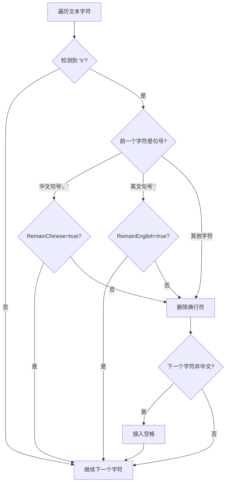

## 前言

决定开一个新的标签叫文档。昨天读[电脑玩物的一篇文章](https://www.playpcesor.com/2026/03/ai-chatgptcodexopenclaw.html)，才意识到AI时代，形成自己的文档和工作流是最重要的。所以这里记录一些可以直接丢给AI，让AI去读取并完成的文档。

Talk is uesless, show AI the code.

（以及：其实下面这个文档也是让AI总结的，算法来源：[Copy++](https://github.com/CopyPlusPlus/CopyPlusPlus)，[DeepWiki](https://deepwiki.com/search/pdf_a90af703-7e2b-4a6c-915a-ce1828ca3bec?mode=fast)总结的

## 正文

``````````
## 核心算法

换行合并的核心算法在 `MainWindow.xaml.cs` 的 `ProcessText` 方法中实现 [1](#0-0) ：



## 算法实现细节

### 1. 换行符检测与删除
当检测到 `\r` 字符时，算法会尝试删除2个字符（`\r\n`），如果失败则删除1个字符（`\r`） [2](#0-1) 。

### 2. 智能保留段落换行
算法通过检查换行符前的字符来判断是否应该保留换行 [3](#0-2) ：
- 中文句号 `。` + `RemainChinese` 设置 → 保留换行
- 英文句号 `.` + `RemainEnglish` 设置 → 保留换行

### 3. 可读性优化
删除换行后，如果下一个字符不是中文标点、空格或中文字符，算法会自动插入一个空格 [4](#0-3) 。

## 触发机制

这个换行合并功能可以通过以下方式触发 [5](#0-4) ：
1. **自动处理**：当 `SwitchMain.IsOn` 为 true 时自动执行
2. **手动处理**：通过 `Manual.xaml.cs` 中的 `MergeLineBtn_Click` 方法手动触发 [6](#0-5) 

## 配置选项

用户可以通过以下设置控制换行合并行为 [7](#0-6) ：
- `RemainChinese`：保留中文段落换行
- `RemainEnglish`：保留英文段落换行
- `SwitchMain`：启用/禁用换行合并功能

这个算法巧妙地解决了PDF复制时的格式问题，既清理了多余的换行，又保持了文章的段落结构，大大提升了文本复制的可用性。

## Notes
- 相同的换行合并逻辑在 `Manual.xaml.cs` 中也有实现，用于手动处理场景
- 算法还处理了CAJ阅读器产生的特殊空格字符 `""` [8](#0-7) 
- 该功能是CopyPlusPlus的核心功能之一，专门针对学术论文复制场景优化

Wiki pages you might want to explore:
- [Overview (CopyPlusPlus/CopyPlusPlus)](/wiki/CopyPlusPlus/CopyPlusPlus#1)
- [Text Processing Pipeline (CopyPlusPlus/CopyPlusPlus)](/wiki/CopyPlusPlus/CopyPlusPlus#4)
- [Translation Services (CopyPlusPlus/CopyPlusPlus)](/wiki/CopyPlusPlus/CopyPlusPlus#4.2)

### Citations

**File:** MainWindow.xaml.cs (L53-55)
```csharp
        public bool RemainChinese;
        public bool RemainEnglish;

```

**File:** MainWindow.xaml.cs (L194-195)
```csharp
            // 去掉 CAJ viewer 造成的莫名的空格符号
            text = text.Replace("", "");
```

**File:** MainWindow.xaml.cs (L200-203)
```csharp
            if (SwitchMain.IsOn || SwitchSpace.IsOn)
                if (text.Length > 1)
                    for (var counter = 0; counter < text.Length; ++counter)
                    {
```

**File:** MainWindow.xaml.cs (L205-231)
```csharp
                        if (SwitchMain.IsOn && counter >= 0 && text[counter] == '\r')
                        {
                            if (counter > 0)
                            {
                                // 如果检测到句号结尾,则不去掉换行
                                if (text[counter - 1] == '。' && RemainChinese) continue;
                                if (text[counter - 1] == '.' && RemainEnglish) continue;
                            }

                            // 去除换行
                            try
                            {
                                text = text.Remove(counter, 2);
                            }
                            catch
                            {
                                text = text.Remove(counter, 1);
                            }

                            --counter;

                            // 判断 非负数越界 或 句末
                            if (counter >= 0 && counter != text.Length - 1)
                                // 判断 非中文 结尾, 则加一个空格
                                if (!Regex.IsMatch(text[counter].ToString(), "[\n ，。？！《》\u4e00-\u9fa5]"))
                                    text = text.Insert(counter + 1, " ");
                        }
```

**File:** Manual.xaml.cs (L30-73)
```csharp
        private void MergeLineBtn_Click(object sender, RoutedEventArgs e)
        {
            if (_lineStatus) return;
            _lineStatus = true;

            if (!Clipboard.ContainsText()) return;

            var text = Clipboard.GetText();

            if (text.Length > 1)
                for (var counter = 0; counter < text.Length; ++counter)
                    // 合并换行
                    if (counter >= 0 && text[counter] == '\r')
                    {
                        if (counter > 0)
                        {
                            // 如果检测到句号结尾,则不去掉换行
                            if (text[counter - 1] == '。' && _mainWindow.RemainChinese) continue;
                            if (text[counter - 1] == '.' && _mainWindow.RemainEnglish) continue;
                        }

                        // 去除换行
                        try
                        {
                            text = text.Remove(counter, 2);
                        }
                        catch
                        {
                            text = text.Remove(counter, 1);
                        }

                        --counter;

                        // 判断 非负数越界 或 句末
                        if (counter >= 0 && counter != text.Length - 1)
                            // 判断 非中文 结尾, 则加一个空格
                            if (!Regex.IsMatch(text[counter].ToString(), "[\n ，。？！《》\u4e00-\u9fa5]"))
                                text = text.Insert(counter + 1, " ");
                    }

            Clipboard.SetDataObject(text);

            _lineStatus = false;
        }
```
``````````