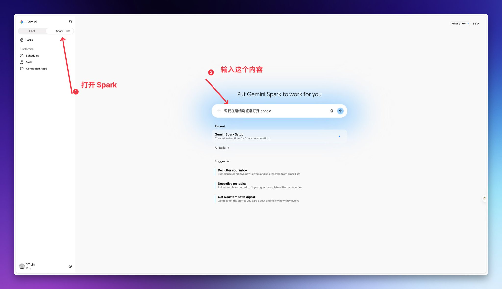
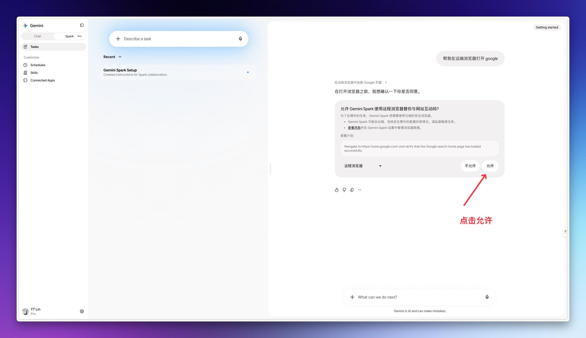
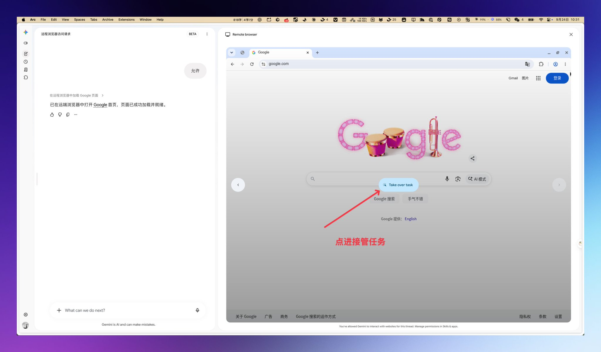
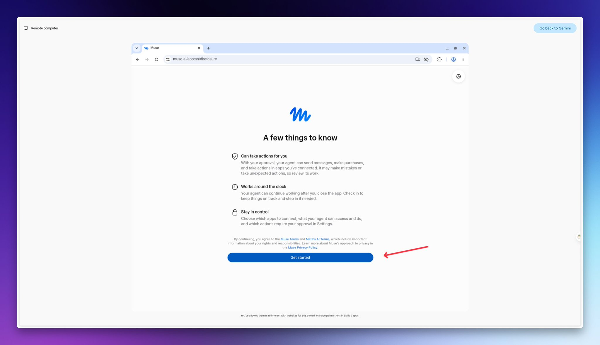
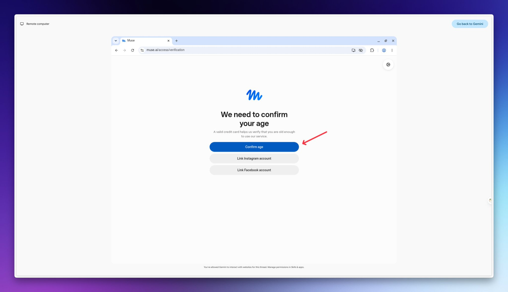
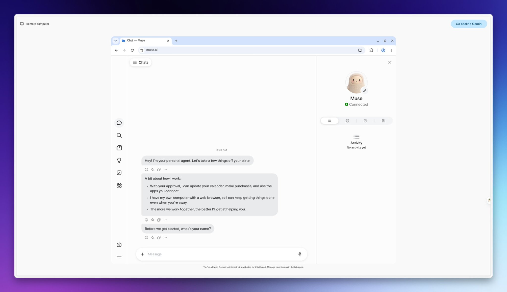
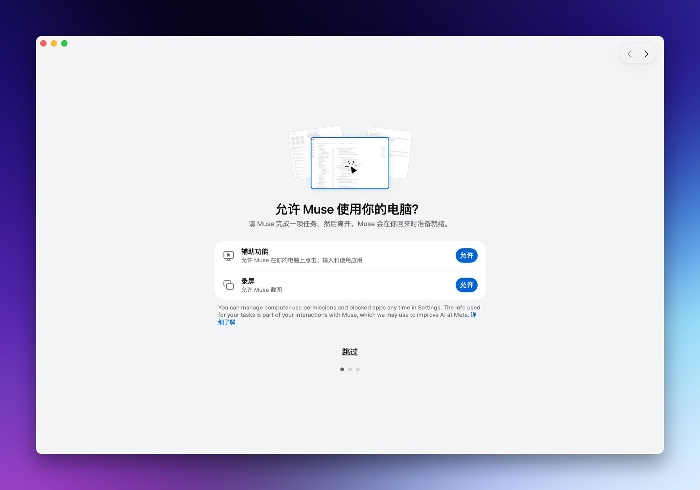

## 前言

我就是用 Gemini Pro 的 Spark 模式把 Muse 注册下来的。今天把这套方法捋一遍，照着点就行，没什么弯弯绕绕。

关键就一点：别在本地浏览器里直接注册，改用 Spark 里的远程浏览器走一遍，完了回本地登录。

<!-- more -->

## 正文

先把 Gemini 打开，切到 Spark。在输入框里告诉它，帮我在远程浏览器打开 Google。

然后它会弹出来问你，允不允许用远程浏览器跟网站互动。点允许就行，不允许后面全白搭。

远程浏览器一打开，你先点那个“接管任务”，自己接手。到了这一步，后面就跟平时注册账号差不多了，只不过浏览器不是你本地那个。

打开 muse.ai/join，填邮箱、填生日，收个验证码。完了会到一个介绍页，点 Get started 往下走。

再往下就是确认年龄。这儿给了三个选项，信用卡、Instagram、Facebook，哪个顺手用哪个。我走的是 Facebook 那条路，用的还是我的老号，点 Link Facebook account，授权一下就过去了，省得再绑卡。

走到这一步，基本就成了。Muse 那边显示 Connected，说明账号已经连上了。

最后回到本地电脑，登录，顺手把该给的权限给了。辅助功能、录屏，该允许的允许，不想给的也可以跳过，反正不影响先用起来。

## 小结

就这么点事。自己走一遍，账号从头到尾都在自己手里，验证码也不用发给陌生人，踏实多了。

---

转载信息：原文作者阿蔺（@alin_zone），原文链接：https://x.com/alin_zone/status/2103018315555754331，注册入口：https://muse.ai/join
